# qwen-mem-lite - Architecture

Generated 2026-09-05 against v3.96.0; **§3 and §4 regenerated 2026-09-06** on the
skill-registry removal branch (R9, `docs/audits/20260906-145304.md`), which deleted 11 source
modules - the previous §3/§4 named every one of them. Two earlier changes still govern how to
read them: the whole-tree reformat (`36f8c0f`) means **every LINE COUNT in §4 is post-reformat
and must not be compared with a figure quoted before it**, and edge extraction moved onto the
AST (P2-9), so §3's edge counts supersede any earlier quote. §1/§2/§5 hand-maintained; the
registry entries in them were removed by hand in the same pass.

Sections 3 and 4 are **tool output** - regenerate them rather than editing by hand:

```
npm run audit:deps        # §3 dependency matrix / upward edges / hubs / mermaid
npm run audit:inventory   # §4 module table (layer · lines · responsibility · exports)
```

Sections 1, 2 and 5 are hand-written from reading the entry points (`hook.mjs`,
`server.mjs`, `cli.mjs`, `install.mjs`, `hooks/hooks.json`, the three `scripts/*.js` hooks)
and are the part that needs a human when the flows change. Every claim below names the
file it was read from; a line without a file is an inference and is marked as such.

## 1. What it is

A persistent-memory plugin for Qwen Code and Claude Code. One SQLite database
(`~/.qwen-mem-lite/`, `better-sqlite3` + FTS5) holds observations, user prompts,
sessions and events. Three **faces** expose it:

| Face | Entry | Transport |
|---|---|---|
| Hooks | `hooks/hooks.json` → `scripts/hook-launcher.mjs` → `hook.mjs` / `scripts/*.js` | Qwen Code / Claude Code hook events, stdin JSON → stdout text / `additionalContext` |
| MCP server | `server.mjs` | stdio JSON-RPC, 10 core definitions + 9 hidden tools; search feedback is telemetry-only (`tool-schemas.mjs`) |
| CLI | `cli.mjs` → `mem-cli.mjs` (data) / `install.mjs` (lifecycle) | `qwen-mem-lite <cmd>` |

The faces share logic through `lib/*-core.mjs` (87 modules under `lib/`); the engines
(`search-engine.mjs`, `deep-search.mjs`, `hook-*.mjs`, `schema.mjs`) sit
beside them at the repo root. Rule from `CLAUDE.md`: **shared by two faces → `lib/`;
owned by one face → stays in that face's file.**

## 2. Layers and dependency direction

Layer assignment is `layerOf()` in `scripts/audit-metrics.mjs` - path-based, so the
matrix in §3 is reproducible.

```
entry    cli.mjs · hook.mjs · server.mjs · install.mjs · scripts/*.js hooks · scripts/hook-launcher.mjs
  │
face     mem-cli.mjs · cli/*.mjs · server/*.mjs · adopt-cli.mjs        (arg parsing + rendering)
  │
engine   hook-*.mjs · search-engine · deep-search · rerank · scoring-sql · search-scoring
         haiku-client · schema · memdir · claudemd · tool-schemas …
  │  ▲
lib/     87 shared cores (search-core, save-observation, maintain-core, citation-tracker, …)
  │
leaf     utils.mjs (barrel) · format-utils · project-utils · tfidf · nlp · tier · secret-scrub · stop-words …
```

Measured direction (§3, 2026-09-05): **0 static cycles, 0 lazy cycles** (also pinned by
`tests/import-graph.test.mjs`). The graph is a DAG but **not strictly layered**:

- `lib → engine` has 12 edges. This is by design - a shared core fronts the engine it
  wraps (`lib/search-core.mjs → search-engine.mjs`, `lib/hook-prune.mjs → install.mjs`).
  **None of them reaches the hook layer any more.** Two used to: `lib/lesson-bridge.mjs`
  and `lib/startup-dashboard.mjs` imported `hook-shared.mjs`, which
  `tests/observation-vector-single-writer.test.mjs` waved through as a named exception
  (that file was DELETED with the TF-IDF vector arm in Phase-2; the import-direction rule it
  carried now lives in the shared import-graph guard)
  (audit 2026-09-02 P2-9 → 2026-09-05 P1-2). The three symbols they needed now live in
  `lib/llm-call.mjs`, `lib/quiet-scope.mjs` and `lib/handoff-constants.mjs` - which is
  where 4 of the current 12 come from (`→ haiku-client`, `→ memdir/claudemd/adopt-content`)
  - and the guard's exception is deleted, so `lib/` may now import no `hook-*.mjs` at all.
  (Round 2 recorded 13 here; the 13th was the P2-9 phantom below, gone in round 3.)
- §3's edges are read from the **AST**, so comments and string literals are not edges
  (audit 2026-09-05 P2-9, fixed in round 3). Until then `edgesOf()` regexed raw source and
  counted the commented-out `await import('../hook-optimize.mjs')` at
  `lib/save-enrich.mjs:175` as a live lazy edge into the hook layer - 49 lazy edges where
  there are 48. The same extraction feeds `cycles()`, so that class of miscount could
  report a cycle nobody wrote. `--self-check` now carries YES and NO arms for it.
- `leaf → lib` has 9 edges, all from `utils.mjs`/`tfidf.mjs`/`tier.mjs`/`format-utils.mjs`
  /`secret-scrub.mjs` into small `lib/` leaves (`time-constants`, `private-strip`, `rrf`,
  `resolve-data-dir`, `low-signal-patterns`, `inject-search-core`). `utils.mjs` is a
  backward-compat barrel (v2.21), so "leaf" is a naming convenience, not a layer.

So the honest picture is four tiers - **entry → face → {engine ⇄ lib} → leaf** - with the
middle tier a single mutual layer. Nothing in `lib/` or `engine` imports a face or an entry
(matrix rows `engine`/`lib`: 0 edges into `entry`/`face`).

## 3. Dependency graph (generated: `npm run audit:deps`)

> node scripts/audit-metrics.mjs --deps

Modules: 189 · edges: 642 static + 65 lazy (relative `import`/`export … from` + literal `import()`, read from the AST — comments and string literals are not edges).

### Layer matrix (rows import columns; count of edges)

| from \ to | entry | face | engine | lib | leaf | tooling |
|---|---|---|---|---|---|---|
| **entry** | 2 | 4 | 29 | 153 | 17 | 2 |
| **face** | 0 | 10 | 15 | 57 | 12 | 0 |
| **engine** | 0 | 0 | 29 | 104 | 23 | 0 |
| **lib** | 0 | 0 | 20 | 139 | 61 | 0 |
| **leaf** | 0 | 0 | 1 | 11 | 9 | 0 |
| **tooling** | 0 | 0 | 0 | 6 | 1 | 2 |

### Upward edges (lower layer importing a higher one; tooling excluded): 32

- lib → engine: 20 (sanctioned — shared cores front the engines)
  - `lib/error-recall-core.mjs` → `scoring-sql.mjs`
  - `lib/get-core.mjs` → `search-scoring.mjs`
  - `lib/git-state.mjs` → `claudemd.mjs`
  - `lib/git-state.mjs` → `adopt-content.mjs`
  - `lib/inject-search-core.mjs` → `scoring-sql.mjs`
  - `lib/llm-call.mjs` → `haiku-client.mjs`
  - `lib/llm-provider-probe.mjs` → `haiku-client.mjs`
  - `lib/llm-provider-probe.mjs` → `haiku-client.mjs` (lazy)
  - `lib/local-steering.mjs` → `claudemd.mjs`
  - `lib/local-steering.mjs` → `adopt-content.mjs`
  - `lib/quiet-scope.mjs` → `memdir.mjs`
  - `lib/quiet-scope.mjs` → `claudemd.mjs`
  - `lib/quiet-scope.mjs` → `adopt-content.mjs`
  - `lib/save-enrich.mjs` → `haiku-client.mjs` (lazy)
  - `lib/save-enrich.mjs` → `hook-semaphore.mjs` (lazy)
  - `lib/search-core.mjs` → `search-engine.mjs`
  - `lib/search-core.mjs` → `scoring-sql.mjs`
  - `lib/search-telemetry.mjs` → `scoring-sql.mjs`
  - `lib/snapshot-probe.mjs` → `schema.mjs`
  - `lib/timeline-core.mjs` → `search-engine.mjs`
- leaf → lib / engine: 12
  - `bash-utils.mjs` → `lib/file-edge-match.mjs`
  - `bash-utils.mjs` → `lib/bash-file-targets.mjs`
  - `format-utils.mjs` → `lib/time-constants.mjs`
  - `project-utils.mjs` → `lib/edit-distance.mjs`
  - `secret-scrub.mjs` → `lib/private-strip.mjs`
  - `tier.mjs` → `lib/time-constants.mjs`
  - `utils.mjs` → `lib/low-signal-patterns.mjs`
  - `utils.mjs` → `scoring-sql.mjs`
  - `utils.mjs` → `lib/private-strip.mjs`
  - `utils.mjs` → `lib/resolve-data-dir.mjs`
  - `utils.mjs` → `lib/provenance.mjs`
  - `utils.mjs` → `lib/err-sampler.mjs` (lazy)
- other: 0

### Hubs

| Most imported (fan-in) | edges | Most importing (fan-out) | edges |
|---|---|---|---|
| `utils.mjs` | 45 | `hook.mjs` | 66 |
| `lib/time-constants.mjs` | 29 | `mem-cli.mjs` | 59 |
| `lib/inject-search-core.mjs` | 25 | `server.mjs` | 42 |
| `cli-path.mjs` | 22 | `scripts/pre-tool-recall.js` | 27 |
| `lib/atomic-write.mjs` | 16 | `install.mjs` | 26 |
| `lib/data-paths.mjs` | 16 | `hook-llm.mjs` | 21 |
| `schema.mjs` | 16 | `scripts/user-prompt-search.js` | 18 |
| `lib/resolve-data-dir.mjs` | 15 | `hook-shared.mjs` | 16 |
| `lib/scrub-record.mjs` | 13 | `hook-optimize.mjs` | 15 |
| `lib/worker-data-dir.mjs` | 13 | `hook-update.mjs` | 14 |
| `format-utils.mjs` | 11 | `hook-context.mjs` | 12 |
| `lib/provenance.mjs` | 11 | `utils.mjs` | 12 |

### Entry → module graph (mermaid; static edges from entry/face files into engine-layer modules, lib/ and leaves collapsed)

```mermaid
graph LR
  adopt_cli_mjs["adopt-cli.mjs"]
  LIB["lib/ (shared cores)"]
  adopt_cli_mjs --> LIB
  memdir_mjs["memdir.mjs"]
  adopt_cli_mjs --> memdir_mjs
  claudemd_mjs["claudemd.mjs"]
  adopt_cli_mjs --> claudemd_mjs
  adopt_content_mjs["adopt-content.mjs"]
  adopt_cli_mjs --> adopt_content_mjs
  cli_mjs["cli.mjs"]
  cli_mjs -.-> LIB
  install_mjs["install.mjs"]
  cli_mjs -.-> install_mjs
  mem_cli_mjs["mem-cli.mjs"]
  cli_mjs -.-> mem_cli_mjs
  cli_activity_mjs["cli/activity.mjs"]
  cli_activity_mjs --> LIB
  cli_common_mjs["cli/common.mjs"]
  cli_activity_mjs --> cli_common_mjs
  cli_common_mjs --> LIB
  cli_doctor_mjs["cli/doctor.mjs"]
  cli_doctor_mjs --> LIB
  cli_doctor_mjs --> cli_common_mjs
  schema_mjs["schema.mjs"]
  cli_doctor_mjs -.-> schema_mjs
  cli_fts_check_mjs["cli/fts-check.mjs"]
  cli_fts_check_mjs --> schema_mjs
  cli_fts_check_mjs --> cli_common_mjs
  cli_verify_apply_mjs["cli/verify-apply.mjs"]
  cli_verify_apply_mjs --> LIB
  cli_verify_apply_mjs --> cli_common_mjs
  hook_mjs["hook.mjs"]
  hook_mjs --> LIB
  hook_episode_mjs["hook-episode.mjs"]
  hook_mjs --> hook_episode_mjs
  hook_mjs --> schema_mjs
  hook_context_mjs["hook-context.mjs"]
  hook_mjs --> hook_context_mjs
  hook_precompact_mjs["hook-precompact.mjs"]
  hook_mjs --> hook_precompact_mjs
  hook_shared_mjs["hook-shared.mjs"]
  hook_mjs --> hook_shared_mjs
  hook_llm_mjs["hook-llm.mjs"]
  hook_mjs --> hook_llm_mjs
  hook_memory_mjs["hook-memory.mjs"]
  hook_mjs --> hook_memory_mjs
  hook_handoff_mjs["hook-handoff.mjs"]
  hook_mjs --> hook_handoff_mjs
  plugin_cache_guard_mjs["plugin-cache-guard.mjs"]
  hook_mjs -.-> plugin_cache_guard_mjs
  hook_update_mjs["hook-update.mjs"]
  hook_mjs -.-> hook_update_mjs
  hook_mjs -.-> adopt_content_mjs
  hook_mjs -.-> adopt_cli_mjs
  hook_optimize_mjs["hook-optimize.mjs"]
  hook_mjs -.-> hook_optimize_mjs
  install_mjs --> LIB
  install_mjs --> plugin_cache_guard_mjs
  install_mjs -.-> hook_update_mjs
  install_mjs -.-> claudemd_mjs
  install_mjs -.-> schema_mjs
  mem_cli_mjs --> schema_mjs
  mem_cli_mjs --> LIB
  search_scoring_mjs["search-scoring.mjs"]
  mem_cli_mjs --> search_scoring_mjs
  search_engine_mjs["search-engine.mjs"]
  mem_cli_mjs --> search_engine_mjs
  deep_search_mjs["deep-search.mjs"]
  mem_cli_mjs --> deep_search_mjs
  mem_cli_mjs --> hook_optimize_mjs
  mem_cli_mjs --> hook_context_mjs
  mem_cli_mjs --> adopt_cli_mjs
  mem_cli_mjs --> memdir_mjs
  mem_cli_mjs --> cli_common_mjs
  mem_cli_mjs --> cli_fts_check_mjs
  mem_cli_mjs --> cli_doctor_mjs
  mem_cli_mjs --> cli_activity_mjs
  mem_cli_mjs --> cli_verify_apply_mjs
  mem_cli_mjs -.-> hook_llm_mjs
  mem_cli_mjs -.-> hook_update_mjs
  scripts_launch_mjs["scripts/launch.mjs"]
  scripts_launch_mjs -.-> LIB
  scripts_launch_mjs -.-> hook_update_mjs
  scripts_launch_preflight_mjs["scripts/launch-preflight.mjs"]
  scripts_launch_mjs -.-> scripts_launch_preflight_mjs
  scripts_post_tool_recall_js["scripts/post-tool-recall.js"]
  scripts_post_tool_recall_js --> LIB
  scripts_pre_agent_inject_js["scripts/pre-agent-inject.js"]
  scripts_pre_agent_inject_js -.-> LIB
  scripts_pre_agent_inject_js -.-> schema_mjs
  scripts_pre_agent_inject_js -.-> hook_memory_mjs
  scripts_pre_tool_recall_js["scripts/pre-tool-recall.js"]
  scripts_pre_tool_recall_js --> LIB
  scoring_sql_mjs["scoring-sql.mjs"]
  scripts_pre_tool_recall_js --> scoring_sql_mjs
  scripts_user_prompt_search_js["scripts/user-prompt-search.js"]
  scripts_user_prompt_search_js --> schema_mjs
  scripts_user_prompt_search_js --> LIB
  server_mjs["server.mjs"]
  server_mjs --> schema_mjs
  server_mjs --> LIB
  server_mjs --> search_scoring_mjs
  server_mjs --> search_engine_mjs
  server_mjs --> deep_search_mjs
  server_mjs --> hook_shared_mjs
  server_mjs --> cli_common_mjs
  tool_schemas_mjs["tool-schemas.mjs"]
  server_mjs --> tool_schemas_mjs
  server_mjs --> hook_optimize_mjs
  server_fts_check_mjs["server/fts-check.mjs"]
  server_mjs --> server_fts_check_mjs
  server_mjs -.-> hook_update_mjs
  server_fts_check_mjs --> schema_mjs
```



## 4. Module inventory (generated: `npm run audit:inventory`)

### Entry points

| Module | Lines | Responsibility | Public interface (exports; `*` = re-export) |
|---|---|---|---|
| `cli.mjs` | 350 | (no header comment) | (entry — no exports) |
| `hook.mjs` | 4229 | Hook v2 - Cognitive memory architecture Selective encoding, episodic batching, error-triggered recall Hooks (fast <100ms): post-tool-use,… | (entry — no exports) |
| `install.mjs` | 5178 | Installer - Smart install/uninstall/status/doctor | HOOK_SCRIPT_FILES, probeBetterSqlite3Binding, ensureBetterSqlite3Working, copyHookScripts(), migrateLegacyClaudeMemData(), bumpJsonField(), patchClaudeMdVersion() … (+27) |
| `scripts/hook-launcher.mjs` | 659 | Self-healing wrapper for Node hook entry points. Why: pre-v2.84 a stale-manifest bug in hook-update.mjs could leave the install with a hook.mjs that… | (entry — no exports) |
| `scripts/launch-preflight.mjs` | 83 | Detect incomplete installs at MCP server launch. Why: issue #15 — published v2.53.0 npm tarball contains all files, but some users end up with a… | detectMissingImports(), resolveLaunchEntry() |
| `scripts/launch.mjs` | 316 | Auto-installs dependencies then starts MCP server Uses only Node built-ins so it works before npm install Quote a path as ONE shell word for a… | (entry — no exports) |
| `scripts/post-tool-recall.js` | 129 | PostToolUse companion to pre-tool-recall.js for the bind-salience forcing-function (component 2). After an Edit/Write, if a lesson surfaced for this… | (entry — no exports) |
| `scripts/pre-agent-inject.js` | 160 | PreToolUse:Agent/Task hook — subagent dispatch-time memory injection. Plugin hooks do fire inside subagents now (#8848 no longer holds: subagent… | (entry — no exports) |
| `scripts/pre-tool-recall.js` | 1145 | PreToolUse file recall — injects lessons before Edit/Write Lightweight standalone (~30ms): only imports better-sqlite3, fs, path, os, and the… | (entry — no exports) |
| `scripts/user-prompt-search.js` | 1222 | Auto-search memory on user prompt Runs as UserPromptSubmit hook — injects relevant memories before Claude sees the prompt Lightweight: only imports… | corpusFloorScale, hasExplicitSignal(), IDENTIFIER_BYPASS, extractTechIdentifiers(), rowMatchesIdentifier(), searchByFts(), isDirectInvocation() |
| `server.mjs` | 2482 | MCP Server - All-in-one memory system FTS5 search, zero LLM calls, single process | handleSearchForTest(), handleSearchFeedback(), handleRecentForTest(), SAVE_TEXT_LIMITS, clampSaveText(), handleExportForTest(), SPAWN_LOG_RETENTION_MS … (+3) |

### Faces (arg parsing + rendering)

| Module | Lines | Responsibility | Public interface (exports; `*` = re-export) |
|---|---|---|---|
| `adopt-cli.mjs` | 1152 | CLAUDE.md-steering plan (v3.13): CLI handlers for qwen-mem-lite adopt [--all] [--force] [--dry-run] [--status] [--disable/--enable] qwen-mem-lite… | detectCwd(), disableSentinelPath, isAutoAdoptDisabled, cmdAdopt(), silentAutoAdopt(), hasAutoAdoptMarker(), cmdUnadopt() |
| `cli/activity.mjs` | 277 | `qwen-mem-lite activity <save/search/recent/show>`. Extracted from mem-cli.mjs (v2.41, god-module split). Thin wrapper over lib/activity.mjs pure… | cmdActivity() |
| `cli/common.mjs` | 686 | shared helpers used by every per-command file under cli/. Extracted from mem-cli.mjs (v2.41) as first step in the god-module split. Scope: pure… | BOOLEAN_CLI_FLAGS, parseArgs(), FILTER_FLAGS, resetFlagTracking(), inertFilterFlags(), inertFilterFlagNotice(), out() … (+17) |
| `cli/doctor.mjs` | 117 | `qwen-mem-lite doctor --benchmark/--metrics`. Extracted from mem-cli.mjs (v2.41, god-module split). `doctor` without flags is handled upstream by… | cmdDoctor() |
| `cli/fts-check.mjs` | 63 | `qwen-mem-lite fts-check <check/rebuild>`. Extracted from mem-cli.mjs (v2.41, god-module split). | cmdFtsCheck() |
| `cli/verify-apply.mjs` | 196 | `qwen-mem-lite verify-apply <proposals.json> [--project P]` (dry run), `... --apply --digest <d>`, and `qwen-mem-lite verify-apply --undo… | cmdVerifyApply() |
| `mem-cli.mjs` | 4581 | CLI — lightweight command layer for direct memory access No MCP SDK or heavy deps — only imports schema.mjs and utils.mjs | OBS_TIME_FIELDS, formatObsFieldValue, cmdSearchForTest(), run() |
| `server/fts-check.mjs` | 35 | MCP `mem_fts_check` handler. Extracted from server.mjs (v2.41, god-module split). Pure delegate to schema.mjs helpers; Zod filters args.action before… | handleMemFtsCheck() |

### Engines (root modules)

| Module | Lines | Responsibility | Public interface (exports; `*` = re-export) |
|---|---|---|---|
| `adopt-content.mjs` | 204 | CLAUDE.md-steering plan (v3.13): content generators for the qwen-mem-lite managed block (written into <cwd>/CLAUDE.md) and its companion… | PLUGIN_SLUG, CURRENT_SENTINEL_VERSION, buildClaudeMdBlock(), getDetailDoc() |
| `claudemd.mjs` | 764 | Context-file steering (v3.13, two-layout since the Qwen Code fork): primitives for the project-tree managed block at <cwd>/CLAUDE.md AND… | claudeMdPath(), detailDocPath(), contextTargets(), straySentinelLines(), holdsOnlyOwnLines(), holdsOnlyPluginLines(), addAgentsImports() … (+13) |
| `deep-search.mjs` | 659 | Opt-in LLM multi-query / HyDE deep search. This is the EXPLICIT "search harder" path — it is NOT on the passive hook pipeline, which stays… | MAX_VARIANTS, AUTO_DEEP_MIN_RESULTS, AUTO_DEEP_MIN_CORPUS, hasEscalatableCorpus(), autoDeepLlmReady(), shouldEscalateToDeep(), resolveDeepMode() … (+12) |
| `haiku-client.mjs` | 1353 | Unified LLM call wrapper Shared by memory (hook.mjs) and dispatch modules Provider priority: ANTHROPIC_API_KEY (direct Anthropic API) →… | BG_LLM_TIMEOUT_MS, resolveModel(), resolveOpenRouterModel(), resolveOpenAIModel(), detectModeFromEnv(), detectMode(), _resetMode() … (+18) |
| `hook-context.mjs` | 1016 | CLAUDE.md context injection and token budgeting SHARED ENGINE — the `hook-` prefix is historical, not a scope. buildSessionContextLines is imported… | computeAdaptiveWindows(), sectionQuotas(), selectWithTokenBudget(), cleanupClaudeMdLegacyBlock(), buildSessionContextLines(), buildSummaryLines() |
| `hook-episode.mjs` | 577 | episode buffer management Handles file-based episode storage with advisory locking and pending entry recovery | readEpisodeRaw(), episodeFile(), readsFile(), orphanReadsFile(), orphanEpisodeFiles(), lockFile(), acquireLock() … (+10) |
| `hook-handoff.mjs` | 1219 | Cross-session handoff extraction, detection, and injection Extracted for testability — hook.mjs has module-level side effects | WORKING_ON_FIRST_MAX, buildAndSaveHandoff(), detectContinuationIntent(), pickHandoffToInject(), consumeHandoff(), renderHandoffInjection(), extractUnfinishedSummary() |
| `hook-llm.mjs` | 2035 | Background LLM workers for episode extraction and session summaries Extracted from hook.mjs for testability and reduced complexity | retractPreSavedObs(), episodeDiagnosis(), episodeOutputDiagnosis(), recordRetryAttempt(), readRetryStats(), saveObservation(), persistHaikuSummary() … (+25) |
| `hook-memory.mjs` | 721 | — Semantic Memory Injection Search past observations for relevant memories to inject as context at user-prompt time. | formatMemoryLine(), searchRelevantMemories(), IMPERATIVE_POOL_BACKSTOP, rankImperativeCandidates(), selectImperativeLesson(), buildSubagentInjection() |
| `hook-optimize.mjs` | 2124 | LLM-powered database optimization SHARED ENGINE — the `hook-` prefix is historical, not a scope. All three entry surfaces import this: hook.mjs… | distributeBudget(), findReenrichCandidates(), countReenrichCandidates(), executeReenrich(), _normalizeGateOpen(), shouldRunNormalize(), isConceptShaped() … (+17) |
| `hook-precompact.mjs` | 64 | PreCompact hook handler. Fires immediately before Claude Code auto-compaction begins. Emits a fresh <qwen-mem-context> block on stdout so the… | handlePreCompact(), entry() |
| `hook-semaphore.mjs` | 205 | LLM concurrency semaphore Limits concurrent claude -p calls to prevent resource contention | LLM_SEM_MAX, LLM_SEM_TIMEOUT, LLM_SEM_STALE_MS, sleepMs, _setLocalHeldAt(), acquireLLMSlot(), releaseLLMSlot() |
| `hook-shared.mjs` | 747 | Shared infrastructure for hook.mjs and hook-llm.mjs Constants, session management, DB access, LLM calls, process utilities | callLLM*, isQuietHooks*, isAdoptedHere*, effectiveQuiet*, HANDOFF_EXPIRY_CLEAR*, HANDOFF_EXPIRY_EXIT*, HANDOFF_ANCHOR_MAX_AGE* … (+40) |
| `hook-update.mjs` | 1828 | update check and installer via GitHub Releases The SessionStart check (hook.mjs, allowInstall:false) only records and announces a newer release;… | checkForUpdate(), getCachedUpdateBanner(), pendingCachedUpdate(), isUpdateCheckDue(), isPluginMode(), updateCheckDisabledReason(), isDevMode() … (+15) |
| `memdir.mjs` | 476 | Phase B (Invited-Memory plan): memdir.mjs — primitives for the per-project Claude Code memdir at ~/.claude/projects/<encoded>/memory/. The public API… | UserEditedError, BudgetExceededError, encodeProjectPath(), disableSentinelPath(), isAutoAdoptDisabled(), memdirPath(), legacyMemdirPath() … (+9) |
| `plugin-cache-guard.mjs` | 207 | Plugin cache hook sentinel. Claude Code runtime reads plugin hooks from ~/.claude/plugins/cache/<marketplace>/<plugin>/<version>/hooks/hooks.json NOT… | DEFAULT_MARKETPLACE, DEFAULT_PLUGIN, scanPluginCacheHookPollution(), clearPluginCacheHooks(), pluginCacheHookEvents(), hasInstallManagedHooks(), settingsHookCommands() … (+1) |
| `rerank.mjs` | 96 | Shared LLM-rerank core: reorder a top-K candidate list by an LLM relevance read. Used by BOTH the production deep-search rerank stage… | extractRanked(), llmRerankOrder(), defaultRerankLLM() |
| `schema.mjs` | 2262 | shared database schema and initialization Used by both server.mjs (MCP process) and hook.mjs (hook process) Ensures DB + tables exist regardless of… | DB_DIR, DB_PATH, CODE_DIR, CURRENT_SCHEMA_VERSION, initSchema(), auditSessionConsistency(), backfillObservationIndexTerms() … (+14) |
| `scoring-sql.mjs` | 285 | SQL constants for BM25 scoring and temporal decay. Extracted from utils.mjs for focused module boundaries. ─── Why these multipliers exist (read… | DECAY_HALF_LIFE_BY_TYPE, DEFAULT_DECAY_HALF_LIFE_MS, OBS_BM25, SESS_BM25, EVT_BM25, OBS_FTS_COLUMNS, TYPE_DECAY_CASE … (+11) |
| `search-engine.mjs` | 697 | Shared observation-search engine — the single source of truth for FTS5 BM25 ranking, OR fallback, and concept/PRF expansion. A TF-IDF vector arm and… | buildObsFtsQuery(), buildObsFtsParams(), countObsFtsMatches(), countSessionFtsMatches(), countPromptFtsMatches(), countEventFtsMatches(), countSearchTotal() … (+5) |
| `search-scoring.mjs` | 492 | shared search-scoring / ranking helpers: re-ranking, PRF term extraction, concept-expansion — plus the MCP instructions builder and… | buildServerInstructions(), reRankWithContext(), PRF_STOP_WORDS, extractPRFTerms(), expandQueryByConcepts(), autoBoostIfNeeded(), runIdleCleanup() |
| `tool-schemas.mjs` | 1110 | Shared Zod schemas for MCP tool inputs Single source of truth — used by server.mjs (runtime) and contract.test.mjs (validation tests) LLM-friendly… | OBS_TYPE_ENUM, memSearchSchema, memSearchFeedbackSchema, memRecentSchema, memTimelineSchema, memGetSchema, memDeleteSchema … (+14) |

### Shared cores (lib/)

| Module | Lines | Responsibility | Public interface (exports; `*` = re-export) |
|---|---|---|---|
| `lib/activity.mjs` | 241 | activity namespace data layer (T7 v2.31) Pure functions over the events table. No I/O beyond the passed-in db handle. Activity events are NOT… | EVENT_TYPES, saveEvent(), getEvent(), searchEvents(), recentEvents(), promoteInsightEvents() |
| `lib/anthropic-base-url.mjs` | 104 | one resolver for ANTHROPIC_BASE_URL. Two callers need the same answer and used to derive it differently: haiku-client's callModelAPI builds the… | resolveAnthropicBaseUrl() |
| `lib/atomic-write.mjs` | 123 | crash-safe file writes with optional one-time backup. Why: several write paths mutate user-global config that, if torn or clobbered, breaks the user… | atomicWriteFileSync(), atomicCopyFileSync() |
| `lib/bash-file-targets.mjs` | 971 | Which files does a Bash command read or write? Leaf module (path + os only): scripts/pre-tool-recall.js imports it on the PreToolUse fast path, so… | isTransientPath(), isScratchCommandPath(), bashFileTargets() |
| `lib/binding-probe.mjs` | 623 | better-sqlite3 native binding probe + auto-rebuild. Shared by install.mjs (verify after `npm install`) and scripts/launch.mjs (verify before… | NATIVE_BINDING_REBUILD_CMD, NATIVE_BINDING_SOURCE_BUILD_CMD, nativeBindingRepairHint(), BINDING_HEAL_GUARD_ENV, isNativeBindingError(), flattenBindingError(), probeBetterSqlite3Binding() … (+8) |
| `lib/blank-text.mjs` | 21 | "would a reader see nothing here?", the one test every title writer asks. trim() keeps the invisible format characters, so a title of U+200B (zero… | isBlankText() |
| `lib/browse-core.mjs` | 91 | shared data collection for the CLI `browse` / MCP `mem_browse` twin (P2-12, audit 2026-08-14). The tier count + row queries were duplicated and had… | BROWSE_TIERS, BROWSE_TIER_LABELS, getActiveMemorySessionId(), collectBrowseTiers() |
| `lib/citation-tracker.mjs` | 2239 | Citation tracker (P4): scan Claude Code transcript for `#NN` observation-id citations in assistant text, then bulk-increment access_count for matched… | OBS_ID_DIGITS, citationIdRe(), unanchoredInjectedIdRe(), isDismissalAt(), extractCitationsFromTranscript(), addCitationsOf(), classifyCitationContext() … (+41) |
| `lib/cite-back-hint.mjs` | 515 | PostToolUse cite-back hint builder. Fires when a flushed episode edits a file that PreToolUse:Read/Edit had nudged earlier in the same session — the… | buildCiteBackHint(), buildUnsavedBugfixHint(), BUGFIX_NUDGE_MARKER_PREFIX, claimBugfixNudge(), countUnsavedBugfixShape(), addBugfixShapeOf(), bugfixShapeStats() … (+7) |
| `lib/cite-recall-path.mjs` | 77 | the ONE definition of the cite-recall snapshot file's path. Same shape, same failure mode and same fix as lib/cooldown-path.mjs (audit 2026-08-29… | CITE_RECALL_FILE_PREFIX, citeRecallProjectKey(), projectFileKey(), citeRecallPathFor() |
| `lib/cli-flags.mjs` | 72 | CLI numeric-flag validation helper. Extends the audit pattern from #8277 (Number.isInteger + range check) with a single reusable surface that also… | isNumericToken(), parseIntFlag() |
| `lib/cli-project.mjs` | 157 | which project a terminal-invoked CLI command should read. `inferProject()` names the directory the process stands in (CLAUDE_PROJECT_DIR // PWD //… | findGitRoot(), _resetCliProjectCache(), resolveCliProject(), cliWriteProject() |
| `lib/compress-core.mjs` | 165 | Shared "compress old low-value observations into weekly summaries" core. Single source of truth for cmdCompress (CLI), mem_compress (MCP), and… | selectCompressionCandidates(), groupByProjectWeek(), compressGroup() |
| `lib/cooldown-path.mjs` | 57 | the ONE definition of the pre-recall cooldown file's path. The rule (sanitize the session id, cap it at 64 chars, join it to RUNTIME_DIR under a… | COOLDOWN_FILE_PREFIX, cooldownSessionKey(), threadKey(), cooldownPathFor() |
| `lib/data-paths.mjs` | 76 | The three location constants, in a leaf module. They lived in `schema.mjs`, which statically imports `better-sqlite3`. That made the native driver a… | DB_DIR, DB_PATH, CODE_DIR, claudeConfigDir(), ignoredClaudeConfigDir(), claudeConfigDirFor(), claudeStatePath() |
| `lib/db-backup.mjs` | 205 | point-in-time DB snapshot before irreversible maintenance. VACUUM INTO produces a consistent, compact copy of the database (WAL-safe — unlike… | backupBudgetBytes(), BACKUP_EVICTION_GRACE_MS, readSnapshots(), listSnapshots(), enforceBackupBudget(), snapshotDb() |
| `lib/db-busy.mjs` | 18 | "another connection holds the lock". A leaf with no imports, so a hook script can tell a lock wait that ran out from any other write failure without… | isDbBusyError() |
| `lib/db-unusable.mjs` | 647 | the database file is not a usable database. The sibling of lib/schema-skew.mjs, and it exists for the same reason: the throw is correct, and… | DB_UNUSABLE_MARKER_PREFIX, isFtsCorruptionError(), ftsCorruptionRemedy(), FTS_CORRUPTION_REMEDY, isDbUnusableError(), checkSnapshot(), sweepSnapshotChecks() … (+3) |
| `lib/dedup-constants.mjs` | 44 | Dedup / merge similarity thresholds — single source of truth (P10). All values are Jaccard-space (word-set overlap, 0..1) unless noted. They were… | DEDUP_JACCARD_THRESHOLD, AUTO_MERGE_THRESHOLD, MERGE_JACCARD_LOW, MINHASH_PRE_THRESHOLD, MINHASH_PREFILTER, FUZZY_DEDUP_THRESHOLD, FUZZY_BODY_THRESHOLD |
| `lib/deferred-work.mjs` | 617 | — deferred_work data layer Pure-data CRUD + ordinal resolver + transactional closure helper. Decoupled from observations table: different lifecycle,… | insertDeferred(), listOpenWithOrdinal(), openOrdinalOf(), formatDeferMoreHint(), formatDeferListRow(), countStaleOpen(), formatDeferStaleHint() … (+11) |
| `lib/delete-core.mjs` | 150 | shared hard-delete orchestration for the CLI `delete` command (mem-cli.mjs cmdDelete) and the MCP `mem_delete` tool (server.mjs). Both surfaces… | deleteObservations(), previewDeleteRows() |
| `lib/doctor-benchmark.mjs` | 162 | Baseline benchmark capture for v2.31 MVP. Measures (bounded scope): - L2 MCP instructions byte count (cost-per-turn source). - Count of registered… | runBenchmark() |
| `lib/doctor-drift.mjs` | 158 | Dev-drift check: in dev-mode installs (symlinked to project repo), every managed source file in INSTALL_DIR should be a symlink. A regular file means… | checkDevDrift(), HOOK_SCRIPT_ENTRY_POINTS, checkHookScriptDrift() |
| `lib/doctor-hook-interpreter.mjs` | 175 | doctor's hook-interpreter check, extracted from install.mjs. Why it moved, since "it was long" is not one of this repo's `lib/` criteria: the second… | resolveBashHookCount(), checkHookInterpreter() |
| `lib/doctor-modes.mjs` | 31 | the DB-layer `doctor` modes, in one place. `doctor` is one command name with two implementations: install.mjs's health check, which owns `--json`,… | DOCTOR_DB_MODES, doctorDbModeHint() |
| `lib/doctor-stale-temp.mjs` | 224 | What counts as stale temp residue, and - the half that kept drifting - what does NOT. Extracted from install.mjs because the scanner (`doctor`) and… | SWAP_JOURNAL_NAME, SWAP_RESOLVED_NAME, isUpdateResidue, isEpisodeResidue, classifyUpdateResidue(), EPISODE_AGE_LABEL, classifyEpisodeFile() … (+1) |
| `lib/edge-attribution.mjs` | 172 | P1 (D#78): per-(obs, file) edge attribution for pre-tool-recall injections. pre-tool-recall triggers purely on file-edge matches (observation_files),… | readPreRecallFileEdges(), resolveEdgeAttribution() |
| `lib/edit-distance.mjs` | 25 | Levenshtein distance with an early exit, for "did you mean" lists. A leaf (no imports): the CLI's unknown-flag suggester (cli/common.mjs) and the… | editDistance() |
| `lib/env-number.mjs` | 104 | Numeric environment overrides with an explicit failure mode. The idiom this replaces — `Number(process.env.X // DEFAULT)` — has no failure mode at… | envNumber() |
| `lib/episode-input-filter.mjs` | 496 | what the episode summarizer is allowed to learn from (D#69). The llm-episode worker turns a window of tool calls into an `events` row with a lesson.… | entryInputTags(), PROBE_SPAN_MAX, filterSummaryInput(), episodeInputFilterEnabled(), extractDiagnosisLines(), extractDiagnosis(), workerEntryFields() … (+4) |
| `lib/err-sampler.mjs` | 98 | sampled append-only log of swallowed errors. Rationale: debugCatch previously only surfaced errors when QWEN_MEM_DEBUG was on. In production, silent… | maybeSampleError(), _sampleRate(), SAMPLE_LOG_RETENTION_MS |
| `lib/error-recall-core.mjs` | 400 | Error-triggered recall — the SELECTION half of the surface. Why this is a shared core and not left inline in hook.mjs (project convention "shared by… | ERROR_RECALL_LIMIT, DEFAULT_ERROR_RECALL_BM25_FLOOR, CALIBRATED_ERROR_RECALL_BM25_FLOOR, errorRecallBm25Floor(), errorRecallSql(), errorRecallFtsQuery(), selectErrorRecall() |
| `lib/error-recall-gate.mjs` | 185 | Error-triggered recall — the SUPPRESSION half: firings that are real failures of nothing the memory corpus could explain (session-history analysis… | errorRecallSuppression() |
| `lib/events-injection.mjs` | 160 | surface `events` into the passive injection surfaces. HIGH-1 (full audit 2026-07-16): persistHaikuSummary upgrade-deletes every event-typed memory… | searchInjectableEvents(), sessionStartEventsEnabled(), recentInjectableEvents(), renderInjectableEvent() |
| `lib/export-columns.mjs` | 130 | Single source of truth for the observation columns that `export` emits and `restore` reads back. Both the CLI (`cmdExport` in mem-cli.mjs) and the… | EXPORT_COLUMNS, EXPORT_COLUMNS_SQL, EXPORT_FIDELITY_NOTE, buildExportWhere() |
| `lib/fast-summary.mjs` | 596 | The non-LLM session summary — one shape, three callers. Audit 2026-08-22 P2-9. hook.mjs carried three hand-copied versions of "read this session's… | FAST_SUMMARY_LIMITS, TAIL_FLOOR_CHARS, TAIL_MIN_REPLACE, readFastSummarySource(), insertFastSummary(), parseSummaryNotes(), summarySourceLabel() … (+7) |
| `lib/file-edge-match.mjs` | 376 | Single source of truth for the (obs,file) trigger-edge match predicate. Two consumers MUST stay in byte-identical agreement or injection and… | fileMatchClause(), basenameAnySep(), jsonArrayLikeNeedle(), rankFileCandidates(), toolEditPath(), fileMatchParams(), edgesNameOtherFile() |
| `lib/file-intel.mjs` | 196 | pure, zero-dependency builder for the PreToolUse:Read "file intelligence" injection (feature ①). Before Claude reads a file, surface its approximate… | fileIntelEnabled(), estimateContentTokens(), humanTokens(), extractFileSummary(), formatFileIntelLine(), fileIntelFor() |
| `lib/frontmatter.mjs` | 83 | the ONE YAML-frontmatter parser for skill/agent markdown. Audit 2026-09-02 P1-16. There were three, and they were not all the same:… | parseFrontmatter() |
| `lib/get-core.mjs` | 217 | shared core for the CLI `get` / MCP `mem_get` twin (P2-12, audit 2026-08-14). The 23-element OBS_FIELDS array was duplicated verbatim in mem-cli.mjs… | OBS_FIELDS, SESSION_DETAIL_FIELDS, PROMPT_DETAIL_FIELDS, EVENT_DETAIL_FIELDS, fetchPromptDetail(), fetchSessionDetail(), fetchEventDetail() … (+3) |
| `lib/git-state.mjs` | 65 | thin wrapper around git status/stash/HEAD sha (T10b). Used by startup-dashboard (T10c) and continuation-anchor detection (T10d). All calls are… | readGitState() |
| `lib/handoff-constants.mjs` | 43 | cross-session handoff policy, defined once. Moved out of `hook-shared.mjs` (audit 2026-09-05 P1-2): `lib/startup-dashboard.mjs` imported… | HANDOFF_EXPIRY_CLEAR, HANDOFF_EXPIRY_EXIT, HANDOFF_ANCHOR_MAX_AGE, HANDOFF_MATCH_THRESHOLD, UNCONSUMED_HANDOFF_SQL, NOT_EXCLUDED_HANDOFF_SQL, CONTINUE_KEYWORDS … (+1) |
| `lib/hook-prune.mjs` | 352 | settings.json hook-entry classification and reconciliation. Extracted here because TWO faces need it and a direct import would close a cycle:… | isMemHook(), ourInstallRoots(), unconfirmedDeadPrefilters(), isMemHookCommand(), stripMemHooks(), launcherEntryPath(), pruneDanglingMemHooks() |
| `lib/hook-stdin.mjs` | 157 | one bounded stdin reader for every hook entry point. Audit 2026-09-02 P1-9. Six hook processes read the host's JSON payload off stdin and they did it… | DEFAULT_STDIN_MAX_BYTES, TOOL_INPUT_FILE_MAX_BYTES, salvageTruncatedHookEvent(), DEFAULT_STDIN_TIMEOUT_MS, readHookStdin() |
| `lib/hook-stdout.mjs` | 282 | one hook process, at most ONE JSON document on stdout. Claude Code parses a command hook's stdout as a SINGLE JSON document. From the 2.1.233 bundle,… | queueHookContext(), queueHookUpdatedInput(), queueHookSystemMessage(), flushHookStdout(), previewHookContext(), resetHookStdout(), peekHookStdout() |
| `lib/hook-telemetry.mjs` | 185 | unsampled hook-error log. Distinct from lib/err-sampler.mjs: that one writes 1% of swallowed debugCatch errors into ${dbDir}/errors/ for *production… | recordHookError(), countRecentHookErrors(), HOOK_ERROR_RETENTION_MS |
| `lib/hook-text-cap.mjs` | 220 | keep every string the host injects under its 10,000-character cap. Claude Code's hooks reference (code.claude.com/docs/en/hooks, fetched 2026-09-27):… | HOOK_TEXT_CAP, capHookText(), idsShownWhole(), writeCappedHookText(), writePlainHookText(), resetPlainHookText() |
| `lib/id-routing.mjs` | 145 | Shared probe for "ID-not-found-in-requested-source" hints + shared token parser. Used by CLI (mem-cli.mjs, cli/common.mjs re-export) and MCP… | parseIdToken(), bucketIdTokens(), formatSourceOverrideNote(), splitDeferredTokens(), probeOtherSources() |
| `lib/import-jsonl.mjs` | 563 | import a Claude Code JSONL transcript file into the memory DB. One transcript ≈ one Claude Code session; we map: user line -> user_prompts row… | MAX_IMPORT_BYTES, importJsonl() |
| `lib/inject-search-core.mjs` | 98 | the retrieval-side shared core (P2-11, audit 2026-08-14; second cut D#123, 2026-08-16). Shared home for the three SQL atoms that kept drifting across… | liveObsFilterSql(), recencyDecaySql(), injectionRelevanceSql() |
| `lib/injected-ids.mjs` | 324 | the cross-hook injected-ids dedup marker: file name, freshness + same-session gate, and payload shape. Single source of truth for… | injectedIdsFileName(), readInjectedMarker(), MAX_MARKER_IDS, mergeInjectedMarker(), injectedIdKey(), EVENT_ID_PREFIX, lessonIdTokens() … (+1) |
| `lib/install-shape.mjs` | 420 | which code homes does this machine actually RUN? qwen-mem-lite can occupy three code homes at once and they are not interchangeable: plugin cache… | hasManagedCodeInstall(), hasAnyManagedCode(), listPluginCacheVersions(), detectInstallShape(), isUnprovisionedPluginRoot(), probeRuntimeRootsSdk(), probeRuntimeRoots() |
| `lib/keyctx-marker.mjs` | 118 | the one place the SessionStart Key Context render is recorded. Two things happen together because they must describe the SAME set: ① the per-session… | KEYCTX_TOUCH_AFTER_MS, recordKeyContextInjection(), touchKeyContextMarker() |
| `lib/lesson-bridge.mjs` | 43 | pure prompt builder + fail-open Haiku bridge for the comprehension-bridge forcing-function (QWEN_MEM_SALIENCE=bridge). Loaded by… | buildBridgePrompt(), bridgeLesson() |
| `lib/lesson-idents.mjs` | 32 | pure, zero-dependency extractor of code identifiers a lesson names, for the bind-salience PostToolUse "dropped a required reference" check… | extractIdents(), presentIdents() |
| `lib/llm-call.mjs` | 78 | the provider-routed background LLM call (Anthropic API → OpenRouter → any OpenAI-compatible endpoint → claude CLI). It lived in `hook-shared.mjs`,… | callLLM() |
| `lib/llm-provider-probe.mjs` | 258 | "is the configured LLM provider actually usable?" Every keyed-provider dispatcher in haiku-client.mjs degrades to `claude -p` when the API call… | tcpReachable(), llmProviderStatus() |
| `lib/local-steering.mjs` | 1097 | the steering block in <git top-level>/CLAUDE.local.md. Why this file exists (docs/audits/20260929-sandbox-usage-eval.md §8.5, tasks/specs/… | LOCAL_MD, RULES_MD, steeringDetailDocPath(), ensureSteeringDetailDoc(), localSteeringRoot(), isSharedAncestor(), samePath() … (+22) |
| `lib/low-signal-patterns.mjs` | 237 | Single source of truth for LOW_SIGNAL title patterns. "LOW_SIGNAL" = hook-llm fallback titles written when Haiku summarization is unavailable or… | LOW_SIGNAL_PATTERNS, buildLowSignalRegex(), buildNotLowSignalSql(), capNoiseImportance(), isLowYieldChangeObs(), isNoiseObservation() |
| `lib/maintain-core.mjs` | 1336 | Shared maintenance operations — single source of truth for cmdMaintain (CLI), mem_maintain (MCP), and handleAutoMaintain (hook). Pre-extraction each… | STALE_AGE_MS, DEFAULT_RETAIN_DAYS, OP_CAP, SCAN_LIMIT, DUPLICATE_LIMIT, SIMILARITY_THRESHOLD, MINHASH_PRE_THRESHOLD … (+29) |
| `lib/mcp-ownership.mjs` | 24 | Which user-scope MCP registrations are this plugin's own. A leaf (no imports), shared by install.mjs (install / uninstall) and hook-update.mjs (the… | OUR_MCP_SERVER_RE, isOurMcpRegistration() |
| `lib/mem-override.mjs` | 33 | User-explicit "ignore memory" override detector. Mirrors CC built-in memoryTypes.ts:215 ("If the user says to *ignore* or *not use* memory: Do not… | detectMemOverride() |
| `lib/memory-input-guard.mjs` | 37 | The shipped-prompt security control for LLM calls whose INPUT is content this product already stored — episode extraction, session summary, concept… | MEMORY_INPUT_GUARD |
| `lib/metrics.mjs` | 195 | optional time-series metric sink. Rationale: mem_stats --quality gives a snapshot, not a trend. If search latency degrades or the coverage filter's… | recordMetric(), timed(), gcOldMetricShards(), DEFAULT_WINDOW_DAYS, readMetrics(), aggregateMetrics(), formatSummary() |
| `lib/native-binding-hint.mjs` | 193 | friendly, rate-limited hint for an unloadable native DB binding (better-sqlite3 ERR_DLOPEN_FAILED, e.g. a Node version upgrade leaves the prebuilt… | NATIVE_BINDING_HINT_COOLDOWN_MS, NATIVE_BINDING_BROKEN_MARKER, nativeBindingHintDue(), formatHookError(), recordNativeBindingBreakage(), readNativeBindingBreakage(), clearNativeBindingBreakage() |
| `lib/npx-run.mjs` | 39 | Whether this process was started by `npx` / `npm exec` — the ephemeral channel whose files do not persist after exit. A leaf (node: builtins only) so… | isNpxRun() |
| `lib/obs-types.mjs` | 12 | Single source of truth for the observation `type` vocabulary. Audit 2026-07-17 MED-3: this list was hardcoded verbatim in 10 JS sites + the SQL CHECK… | OBS_TYPES, OBS_TYPE_SET |
| `lib/observation-write.mjs` | 286 | Single source of truth for the observations-table write surface. Two ingest paths previously hand-wrote divergent INSERTs — lib/save-observation.mjs… | normalizeScope(), SCOPE_PROMPT_LEGEND, insertObservationRow(), insertObservationFiles(), looksAlreadyDerived(), applyObsUpdate() |
| `lib/patha-exclude-meter.mjs` | 278 | the ruler D#213 named as its only blocker. D#213 (which replaced D#212, which replaced D#193) is not open because the mechanism is unclear. The… | PATHA_EXCLUDE_EVENT, pathAMeterEnabled(), markerTypeSplit(), coerceMarkerIds(), suppressedByWorkingExclude(), inertMarkerIds(), measurePathAExclude() … (+1) |
| `lib/paused-reader.mjs` | 177 | read the newest `tasks/<slug>-paused.md` in a project. A paused note is the one place a session writes down BY HAND what is left and how to verify… | readPausedNote() |
| `lib/persist-reminder.mjs` | 128 | Unpersisted-decision reminder — G3 (roadmap 2026-07-18). The write-side other half of the D#92 incident: that deferred item was recoverable only… | detectFinalization(), countDeliberatePersistence(), deliberatePersistenceIn(), detectUnpersistedDecision() |
| `lib/plan-reader.mjs` | 41 | list recent plan files under ~/.claude/plans/ (T10b). For startup-dashboard (T10c); pure function; silent on I/O errors. Real schema observed in… | recentPlans() |
| `lib/platform-gate.mjs` | 87 | is THIS platform inside the `os` list package.json declares? Why this is a module and not four lines inside scripts/launch.mjs, which is its only… | platformAllowed(), readDeclaredPlatforms(), platformGate() |
| `lib/plugin-key.mjs` | 112 | the plugin's identity in Claude Code's settings, and the one predicate that reads it. Audit 2026-09-02 P2-7. `PLUGIN_KEY` and… | MARKETPLACE_KEY, PLUGIN_NAME, PLUGIN_KEY, isPluginExplicitlyDisabled(), pluginSettingsScopes(), isPluginDisabledInScopes(), isPluginDisabledForProject() … (+1) |
| `lib/private-strip.mjs` | 83 | Strip <private>...</private> blocks from user-supplied text before any persistence or downstream processing. Use case: user wraps sensitive content… | stripPrivate() |
| `lib/proc-lock.mjs` | 384 | best-effort inter-process advisory lock (O_EXCL file). Why: multiple Claude Code sessions can fire SessionStart hooks (and their self-heal /… | LIVE_HOLDER_MAX_MS, acquireLock(), takeLock(), lockHeld(), lockDirBlocked(), withLock(), withLockAsync() |
| `lib/project-link.mjs` | 147 | Leaf (node: imports only): whether the plugin may write a project file reached through a link. A cloned repository can commit links, and the plugin… | linkRefusal(), refusalText() |
| `lib/project-rekey.mjs` | 182 | D9 part 2: move a project's rows from the id the pre-D9 naming rule gave it to the new one. Before D9, projectNameFromDir kept ASCII alone, so… | PROJECT_REKEY_MARKER_PREFIX, legacyProjectNameFromDir(), rekeyLegacyProject(), legacyIdIsExclusive(), moveProjectRows() |
| `lib/prompt-admission.mjs` | 68 | which prompts the UserPromptSubmit recall faces search on at all. That event fires two hooks: scripts/user-prompt-search.js (path A, the FYI block)… | isNoTopicShape(), meetsRecallLengthFloor() |
| `lib/provenance.mjs` | 70 | Which writer produced an observation, read back from its memory_session_id. saveObservation writes every explicit save under… | MANUAL_SESSION_ID_PREFIX, writerSessionId(), HOOK_SESSION_ID_PREFIX, hookSessionId(), isAutoWritten(), autoTag, autoLegend … (+2) |
| `lib/proxy-fetch.mjs` | 443 | HTTPS over an HTTP CONNECT tunnel, using node: built-ins only. Node's global fetch (undici) does NOT honour HTTP(S)_PROXY unless the user opts in… | httpConnectProxyFor(), redactProxyUrl(), connectProbeViaProxy(), onceViaConnectProxy(), postDirectHttp(), requestViaConnectProxy(), getViaConnectProxy() … (+1) |
| `lib/quiet-scope.mjs` | 99 | "should this surface stay quiet here?", defined once. Moved out of `hook-shared.mjs` (audit 2026-09-05 P1-2): `lib/startup-dashboard.mjs` imported… | isQuietHooks(), isAdoptedHere(), effectiveQuiet() |
| `lib/recall-core.mjs` | 128 | Single source of truth for file-keyed recall: the observation_files junction query, LIKE-wildcard escaping, noise filtering, and the access-count… | recallByFile(), countRecallableByFile() |
| `lib/recall-framing.mjs` | 95 | the first line of a PreToolUse / PostToolUse recall block, in two wordings. The legacy line announces itself as "system-injected context, continue… | recallFramingArm(), recallFramingLine(), classifyRecallFraming() |
| `lib/recall-shown.mjs` | 206 | what one THREAD has already been shown once: the recall framing header and the full cite directive (injection budget C1 / C3,… | RECALL_SHOWN_PREFIX, ACK_DIRECTIVE, ACK_DIRECTIVE_SHORT, planRecallBlock(), recallShownPath(), readRecallShown(), markRecallShown() … (+5) |
| `lib/recent-core.mjs` | 71 | Shared "most recent live observations" core for cmdRecent (CLI `recent`) and runRecent (MCP mem_recent). `recent` was the last retrieval command… | RECENT_MAX, fetchRecent() |
| `lib/recent-table.mjs` | 49 | how many rows the SessionStart `### Recent` table shows, and which (injection budget C4, docs/audits/20261016-injection-budget-baseline.md). The… | recentTableRowCap(), capRecentRows() |
| `lib/record-once.mjs` | 76 | "has this condition already been logged recently, for this project?" Extracted from lib/schema-skew.mjs when a SECOND unhealable DB-open family… | RELOG_INTERVAL_MS, shouldRecordOnce() |
| `lib/regular-file.mjs` | 58 | read a file only when it is a regular file, and only up to a byte limit. For paths someone else can occupy: the instruction files above a project… | readRegularText(), readRegularTextOrThrow() |
| `lib/release-digest.mjs` | 109 | shared release-signing core (P1 supply-chain hardening). One source of truth for BOTH sides of the auto-update authenticity check so the CI signer… | sha256Hex(), sha256File(), buildReleaseManifest(), serializeManifest(), verifyReleaseFiles(), verifyManifestSignature() |
| `lib/relevance-floor.mjs` | 149 | Corpus-size normalization for ABSOLUTE relevance floors. Extracted from scripts/user-prompt-search.js (v3.61.0) when a second injection face —… | corpusFloorScale() |
| `lib/reread-guard.mjs` | 63 | pure logic + one IO helper for feature ② (repeated-read guard). When the agent does a full Read of a file it already read this session and the file… | readFileMeta(), shouldWarnReread(), buildRereadWarning() |
| `lib/resolve-data-dir.mjs` | 152 | Single source of truth for resolving the QWEN_MEM_DIR data directory. Zero runtime deps (node:path + node:os only) so hot-path hook scripts can… | resolveDataDir(), resolveRuntimeDir() |
| `lib/rrf.mjs` | 61 | Reciprocal Rank Fusion core (single source of truth, D#42). deep-search.rrfFuseN (N-list, full-row output with best-rank row selection) is a thin… | RRF_K, rrfAccumulate() |
| `lib/save-enrich.mjs` | 257 | Save-time background enrichment - G1+G2 (roadmap 2026-07-18). The v3.49 save-nudge REMINDS the caller to write a lesson; nothing backfills when the… | ENRICH_OBLIGATED_TYPES, shouldQueueSaveEnrich(), saveEnrichNote(), queueSaveEnrich(), executeSaveEnrich() |
| `lib/save-nudge.mjs` | 26 | Save-time lesson nudge (audit 2026-07-17 P4): bugfix/decision are the types whose value lives in the lesson (root cause + fix / constraint +… | buildLessonNudge() |
| `lib/save-observation.mjs` | 533 | Shared "save one observation" pipeline — used by both mem-cli.mjs::cmdSave (CLI `qwen-mem-lite save`) and server.mjs::mem_save (MCP tool).… | splitSupersedeTokens(), formatSupersededNote(), formatSupersedeSkipped(), saveObservation(), saveWithClosures() |
| `lib/schema-skew.mjs` | 375 | the DB is NEWER than the code trying to open it. schema.mjs's forward-incompat guard has thrown on this for a long time and the throw is correct: an… | SCHEMA_SKEW_CODE, SKEW_MARKER_PREFIX, SKEW_RELOG_INTERVAL_MS, shouldRecordSkew(), isSchemaSkewError(), schemaSkewFromError(), schemaSkewRemedy() … (+4) |
| `lib/scrub-record.mjs` | 200 | per-table scrub helper. Applies scrubSecrets to the known text fields of a table row. Numeric / JSON-blob / id fields are passed through untouched.… | TEXT_FIELDS_BY_TABLE, scrubFilePath(), scrubFilePaths(), scrubRecord() |
| `lib/search-core.mjs` | 1207 | Shared cross-source search core for cmdSearch (CLI) and mem_search (MCP). coreRunSearchPipeline (below) is the SINGLE orchestration body — deep /… | buildSearchFtsQuery(), ignoredOperatorNote(), parseDuration(), parseDateBounds(), MIN_FUSION_POOL, computePerSourceWindow(), effectiveObsFtsQuery() … (+9) |
| `lib/search-telemetry.mjs` | 529 | A rating is a deliberate act, so it waits this long for a hook holding the writer; at 0 it was lost with "database is locked" (D#245 N2). Recording a… | ensureSearchTelemetrySchema(), recordSearch(), rateSearchResults(), countMcpEligibleCorpus(), computeSearchTelemetry(), formatSearchTelemetryReport() |
| `lib/shard-gc.mjs` | 54 | retention sweep for daily JSONL shard directories. `lib/metrics.mjs` (QWEN_MEM_METRICS) appends one `YYYY-MM-DD.jsonl` per day with no GC of its own,… | gcDailyShards() |
| `lib/snapshot-probe.mjs` | 74 | what restoring one backup snapshot would give (D#558). Run as a CHILD by lib/db-unusable.mjs `checkSnapshot`, with QWEN_MEM_DIR set to a private… | probeOpenedStore() |
| `lib/startup-dashboard.mjs` | 170 | aggregates git/tasks/plans/handoff state into a single SessionStart injection line (T10c v2.31; the events count left in the injection-budget… | buildDashboard() |
| `lib/stats-core.mjs` | 199 | shared primary stats feed for CLI `stats` and MCP `mem_stats`. Audit 2026-07-17 MED-4: these ~15 COUNT/GROUP-BY queries were hand-copied… | computeStatsFeed() |
| `lib/stats-quality.mjs` | 232 | Shared quality-dashboard computation — used by both mem-cli.mjs (CLI `stats --quality`) and server.mjs (MCP `mem_stats({quality: true})`). Splits… | computeNoiseGauge(), computeQualityStats(), formatQualityReport() |
| `lib/summary-extractor.mjs` | 309 | Structured summary extractor: reads the tail assistant message from a Claude Code transcript and pulls out Done / Not done / Failed / Uncertain… | extractTailAssistantText(), extractStructuredSummary() |
| `lib/task-imperative.mjs` | 58 | pure formatter for the task-imperative memory line. Shared by the live UserPromptSubmit emitter (Phase 2) AND efficacy arm U (the measurement that… | TASK_IMPERATIVE_PREFIX, formatTaskImperative(), formatSubagentContext() |
| `lib/task-reader.mjs` | 147 | parse ~/.claude/tasks/<taskListId>/*.json for startup dashboard (T10a). Pure function over the filesystem. Filters to pending + in_progress tasks for… | readProjectTasks() |
| `lib/time-constants.mjs` | 104 | millisecond time units, defined once. Four modules each carried their own `const DAY_MS` (deferred-work, metrics, err-sampler, hook-telemetry) with… | DAY_MS, ORPHAN_EPISODE_AGE_MS, PRETOOL_LOOKBACK_MS, DB_BUSY_TIMEOUT_MS, HOOK_DB_DEADLINE_MS, SERVER_OPEN_BUSY_RETRY_MS, SESSION_START_DB_DEADLINE_MS … (+2) |
| `lib/timeline-core.mjs` | 342 | Shared "timeline around an anchor" core. Single source of truth for cmdTimeline (CLI) and mem_timeline (MCP). Pre- extraction the anchor-resolution… | resolveAnchorToken(), formatAnchorError(), resolveQueryAnchor(), fetchRecentTimeline(), fetchTimelineWindow() |
| `lib/tmp-fixture-sweep.mjs` | 102 | Sweep stale qwen-mem-lite test-fixture directories from temp dirs. Tests create sandboxes via mkdtempSync(join(tmpdir(), '<prefix>')) and clean them… | TEST_FIXTURE_PREFIXES, DEFAULT_FIXTURE_AGE_MS, sweepStaleTestFixtures() |
| `lib/tool-names.mjs` | 64 | the one place that knows a second host's tool vocabulary. The pipeline speaks Claude Code's dialect. Skip lists, EDIT_TOOLS, makeEntryDesc,… | normalizeToolName(), QWEN_TOOL_IDS |
| `lib/tool-refusal.mjs` | 117 | Did this tool call fail because a PROGRAM failed, or because the agent's own tool chain said no? WHY THIS EXISTS. Claude Code delivers host-flagged… | REFUSAL_SENTINELS, isToolChainRefusal(), shouldRecallOnFailure() |
| `lib/transcript-digest.mjs` | 350 | Stop's transcript questions, answered from the bytes appended since the previous Stop. Issue #53. Stop fires once per assistant turn, and it answered… | DIGEST_FILE_PREFIX, DIGEST_BYTES_PER_STOP, digestTranscript(), digestFileName() |
| `lib/transcript-scan.mjs` | 186 | One parse of a Claude Code transcript, shared by everything that scans it. Audit 2026-08-22 P2-8. handleStop asked the same .jsonl the same question… | TRANSCRIPT_ENTRY_HEAP_FACTOR, TRANSCRIPT_CACHE_MAX_BYTES, transcriptCacheBudgetBytes(), readTranscriptEntries(), _resetTranscriptCache() |
| `lib/turn-replies.mjs` | 91 | D#825 — each turn's last reply, recorded at Stop under the memory session that answered it, for the session summary worker (D19 + D22). Reading the… | TURN_REPLIES_PREFIX, TURN_REPLY_MAX_CHARS, turnRepliesPath(), recordTurnReply(), readTurnReplies() |
| `lib/upgrade-banner.mjs` | 78 | One-shot v2.70.0 upgrade banner. Split out of hook.mjs because hook.mjs has module-level side effects (notably `if (!event) process.exit(0)` at top… | V270_RELEASE_EPOCH, hasPreV270Data(), emitV270UpgradeBanner() |
| `lib/ups-query.mjs` | 39 | the ONE query-cap definition for the UserPromptSubmit event. That event fires two hooks: scripts/user-prompt-search.js (the FYI block) and `hook.mjs… | UPS_QUERY_CAPS, upsFtsQuery(), upsQueryTerms() |
| `lib/verify-apply-core.mjs` | 650 | the deterministic write half of /verify. Design notes live outside the repository; commands/verify.md is the shipped contract. The judgement ("is… | VERIFY_RETIRED_MARKER, parseProposals(), planVerifyApply(), priorVerifyApplies(), planDigest(), applyVerifyPlan(), readBackVerifyPlan() … (+3) |
| `lib/wal-open-blocked.mjs` | 69 | a closed WAL store in a data dir this user cannot write (D#287, D#296). The store is WAL (schema.mjs), and even a read-only open has to create the… | WAL_BLOCKED_WHY, dirAccessError(), walOpenBlocked(), dataDirRemedy |
| `lib/worker-data-dir.mjs` | 34 | a background worker never re-creates a data dir removed while it ran. spawnBackground's workers are detached and can live a minute (a delay plus an… | backgroundWorkerEnv(), workerDirGone() |

### Leaf utilities (root)

| Module | Lines | Responsibility | Public interface (exports; `*` = re-export) |
|---|---|---|---|
| `bash-utils.mjs` | 1116 | Bash command analysis and file path extraction Extracted from utils.mjs for focused responsibility One import into a module that had exactly one, and… | isTransientPath, isDataPrintingCommand(), detectBashSignificance(), extractErrorKeywords(), planErrorRecall(), extractFileTargets(), extractFilePaths() … (+1) |
| `cli-path.mjs` | 35 | single source of truth for invoking the bundled CLI by an absolute, install-shape-independent path. cli.mjs is a sibling of this module at the… | CLI_PATH, shellWord, CLI_INVOKE |
| `format-utils.mjs` | 397 | String formatting and display utilities Extracted from utils.mjs for focused responsibility Collapse a value to ONE line: newlines to spaces, then… | normalizeInline(), truncate(), QUERY_LABEL_MAX, queryLabel(), neutralizeContextDelimiters(), safeText(), neutralizeSkillDelimiters() … (+7) |
| `hash-utils.mjs` | 160 | Hashing and similarity utilities Extracted from utils.mjs for focused responsibility Compute word-level Jaccard similarity between two strings.… | jaccardSimilarity(), jaccardSimilarityCjk(), computeMinHash(), estimateJaccardFromMinHash() |
| `nlp.mjs` | 557 | FTS5 query building, synonym expansion, CJK tokenization. Extracted from utils.mjs for focused module boundaries. Re-export for backward… | SYNONYM_MAP, CJK_COMPOUNDS, cjkBigrams(), gluedAsciiRuns(), cjkIndexTerms(), missingCjkIndexTerms(), eventSearchTerms() … (+9) |
| `project-utils.mjs` | 324 | shared project resolution Extracted from server.mjs and mem-cli.mjs to eliminate duplication Leaf module: imports nothing from utils.mjs. utils.mjs… | inferProject(), inferProjectDir(), projectNameFromDir(), likeLiteral(), resolveProject(), checkWriteProject(), unknownProjectNote() … (+1) |
| `secret-scrub.mjs` | 1761 | Secret pattern detection and scrubbing Extracted from utils.mjs for focused responsibility ─── Secret Patterns… | SECRET_PATTERNS, scrubSecrets() |
| `skip-tools.mjs` | 33 | Single source of truth for tools skipped in post-tool-use processing. Used by hook.mjs (Node) and validated against scripts/post-tool-use.sh (bash).… | SKIP_TOOLS, SKIP_PREFIXES |
| `source-files.mjs` | 495 | Shared runtime source-file manifest — imported by install.mjs and hook-update.mjs so the two code paths never drift. Adding a new .mjs that any entry… | SOURCE_FILES, HOOK_SCRIPT_FILES, RELEASE_SIGNED_FILES |
| `stop-words.mjs` | 168 | Shared base stop-word set for all NLP/search modules. Single source of truth: consumers extend with domain-specific extras. Common English stop words… | BASE_STOP_WORDS, CJK_STOP_WORDS |
| `synonyms.mjs` | 778 | Unified synonym data for FTS5 search and dispatch. Consolidates SYNONYM_PAIRS/SYNONYM_MAP (from nlp.mjs) and DISPATCH_SYNONYMS (formerly… | SYNONYM_PAIRS, SYNONYM_MAP, CJK_COMPOUNDS, DISPATCH_SYNONYMS |
| `tfidf.mjs` | 189 | the Porter stemmer. NAME IS HISTORICAL. This module was the TF-IDF vector search engine (vocabulary, vectors, cosine similarity, vector search, RRF… | porterStem() |
| `tier.mjs` | 132 | Virtual three-tier memory classification engine Computes tier (working/active/archive) from existing observation fields. No database dependencies —… | ACTIVE_WINDOWS, computeTier(), TIER_CASE_SQL, tierSqlParams(), relativeTime() |
| `utils.mjs` | 803 | shared utilities Used by server.mjs, hook.mjs, and tests Local binding for internal use: the `export … from './secret-scrub.mjs'` re-export below is… | DECAY_HALF_LIFE_BY_TYPE*, DEFAULT_DECAY_HALF_LIFE_MS*, OBS_BM25*, SESS_BM25*, EVT_BM25*, TYPE_QUALITY_CASE*, OBS_FTS_COLUMNS* … (+52) |

### Dev / CI tooling (scripts/)

| Module | Lines | Responsibility | Public interface (exports; `*` = re-export) |
|---|---|---|---|
| `scripts/audit-metrics.mjs` | 1106 | Repeatable code-metrics snapshot for docs/audit/*.md. node scripts/audit-metrics.mjs # JSON to stdout, reuses coverage/ + runs eslint/knip/prettier… | (entry — no exports) |
| `scripts/binding-probe-cli.mjs` | 165 | SessionStart native-binding probe + bounded heal. Contract with scripts/setup.sh: exit 0 = binding usable NOW, non-zero = not. Everything… | (entry — no exports) |
| `scripts/convert-commands.mjs` | 161 | Convert command .md files to SKILL.md skills in managed agent plugins Usage: node scripts/convert-commands.mjs [--dry-run] [--delete-originals] D#29:… | (entry — no exports) |
| `scripts/green-stamp-reporter.mjs` | 113 | the ONLY writer of the pre-commit green stamp. Registered in vitest.config.mjs beside the default reporter. It records the tree key… | refusalReason(), default |
| `scripts/green-stamp.mjs` | 192 | let the pre-commit gate reuse a full-suite pass on the SAME tree. Why: the session-history audit… | STAMP_NAME, STAMP_MAX_AGE_MS, stampPath(), computeTreeKey(), recordStamp(), clearStamp(), loadsStampReporter() … (+2) |
| `scripts/mock-claude.mjs` | 71 | Mock claude CLI for E2E tests — deterministic JSON responses Usage: CLAUDE_CODE_PATH=scripts/mock-claude.mjs Called as: node mock-claude.mjs -p… | (entry — no exports) |
| `scripts/prompt-search-utils.mjs` | 300 | Shared logic for user-prompt-search hook and its tests. Extracted to eliminate code duplication between the hook script and test file. The no-topic… | computeEffectiveLen(), shouldSkip(), INTENTS, detectIntent(), detectMemOverride*, extractErrorSignature(), MAX_SESSION_INJECTIONS … (+6) |
| `scripts/sign-release.mjs` | 59 | CI release signer (P1 supply-chain hardening). Builds release-manifest.json (sha256 of every SOURCE_FILES entry at this checkout) and signs the exact… | (entry — no exports) |
| `scripts/smoke-tarball.mjs` | 237 | Real-install smoke test (audit item ①). The riskiest install path — `npm pack` → real `npm install` of the tarball → better-sqlite3 native rebuild →… | (entry — no exports) |
| `scripts/swap-mixed-tree.mjs` | 314 | Release check (dev only, not shipped; ci.yml's swap-mixed-tree job runs it from the last release tag on every push to main, and it is run by hand… | (entry — no exports) |
| `scripts/validate-plugin-manifests.mjs` | 154 | Runs `claude plugin validate --strict --json` over BOTH manifests and grades the report. Why this exists as well as tests/plugin-manifest.test.mjs:… | ALLOWED_WARNINGS, ALLOWED_ERRORS, collectDiagnostics(), classifyReport(), reportLines() |
| `scripts/write-shrinkwrap.mjs` | 165 | Write npm-shrinkwrap.json for the published tarball: package-lock.json without its dev-only entries (D#170). npm never packs package-lock.json, so… | productionClosure(), verifyShrinkwrap(), buildShrinkwrap() |

## 5. Main flows (≤5 steps each; file:function is where the step was read)

**F1 · Capture** (PostToolUse → observation)
1. `hooks.json` PostToolUse `*` → `scripts/post-tool-use.sh` bash pre-filter drops low-value tools (~5 ms), else spawns `hook.mjs post-tool-use`.
2. `hook.mjs:handlePostToolUse` parses stdin, skips `skip-tools.mjs` names, builds an episode entry (tool, files, isError, cc session id).
3. Entry is appended to the per-project episode buffer under a lock (`hook-episode.mjs`); on 10 entries / 5-min gap, `flushEpisode` → `flushEpisodeGroup`.
4. `flushEpisodeGroup` writes an `ep-flush-*.json` file (owner-only) and spawns `llm-episode` in the background → `hook-llm.mjs:handleLLMEpisode` (Haiku via `haiku-client.mjs`, its own three-tier dedup) → `lib/save-observation.mjs:saveObservation`.
5. Hard errors additionally run `triggerErrorRecall` → `lib/error-recall-core.mjs` and print related memories. Host-flagged failures take the separate PostToolUseFailure path (`handlePostToolFailure`, gated by `lib/tool-refusal.mjs`).

**F2 · Session start injection** (SessionStart → `<claude-mem-context>`)
1. `scripts/setup.sh` (data-dir migration/creation, dependency resolution - its own header) then `hook.mjs session-start`.
2. `handleSessionStart`: GC cooldown/shadow/metric shards, plugin-cache self-heal (`plugin-cache-guard.mjs`), idempotent auto-adopt (`adopt-cli.mjs:silentAutoAdopt`).
3. Flush any leftover episode, mark previous session, save handoff + fast summary (`saveHandoffAndFastSummary`, `hook-handoff.mjs`).
4. `hook-context.mjs:buildSessionContextLines` builds the block: adaptive time window (`tier.mjs`), Key Context pool, token budget.
5. Writes the block to stdout; schedules `auto-maintain` in the background (`scheduleSessionStartAutoMaintain`) and reads the cached update banner / marks the 24 h check due (`hook-update.mjs`, lazy import - never awaited inline).

**F3 · Prompt-time recall** (UserPromptSubmit - two processes, in order)
1. `scripts/user-prompt-search.js:main` - strip `<private>`, mem-override short-circuit (`lib/mem-override.mjs`), deterministic `D#N` deferred injection.
2. Skip gates (`shouldSkip`, length, follow-up); FTS search over observations (`lib/inject-search-core.mjs`, `nlp.mjs`) → dedup against the session marker (`lib/injected-ids.mjs`) → emit `<memory-context>`, bump `injection_count`.
3. `hook.mjs:handleUserPrompt` → `recordUserPromptRow` (prompt row + atomic counter, returns the CC session id), then `injectHandoffIfEarly` for the first 3 prompts of that CC session (`renderHandoffInjection`).
4. `hook.mjs:injectSemanticMemory` → `hook-memory.mjs:searchRelevantMemories`, excluding ids already injected by step 2 (marker file is the cross-process contract).

**F4 · Stop** (turn end → citation accounting)
1. `hook.mjs:readStopHookInput` reads the CC session id and transcript path; `flushEpisodeAtStop` snapshots and flushes the episode buffer (lock, else atomic claim-rename fallback).
2. `markSessionCompletedAndSaveHandoff` (`hook-handoff.mjs:buildAndSaveHandoff`), then `writeFastSummaryBaseline`.
3. `trackCitationsAtStop` scans the transcript for injected ids by surface and for `#NN` citations (`lib/citation-tracker.mjs`, `lib/transcript-scan.mjs`).
4. …and runs `applyCitationDecay(...)` per face (subagent face gated) - citation accounting no longer writes `importance` (D#179/D#198).
5. Emits the cite-recall nudge when due (`buildCiteRecallNudge`).

   (Steps 1-5 were one 470-line `handleStop` until audit 2026-09-05 P2-1; the handler is now 40 lines calling the five phases named above.)

**F5 · Search** (MCP `mem_search` / CLI `search` - one pipeline)
1. Face parses args (`server.mjs:runSearchPipeline` / `mem-cli.mjs:cmdSearch`), sanitizes the FTS query (`utils.mjs:sanitizeFtsQuery`, synonym expansion), resolves deep mode.
2. `lib/search-core.mjs:coreRunSearchPipeline` - FTS5 + BM25 composite (`scoring-sql.mjs`) → OR fallback → concept co-occurrence + PRF expansion (`search-engine.mjs`). The TF-IDF vector merge that used to close this pipeline was removed in Phase-2; RRF now lives only in `deep-search.mjs`.
3. Weak results auto-escalate to `deep-search.mjs` (LLM query rewrite, variants); explicit deep may rerank (`rerank.mjs`).
4. Cross-source merge (observations / prompts / sessions / events), pagination, deferred trailer.
5. Face renders (`formatSearchOutput` / `cli/common.mjs`), MCP output passes `defangResult`.

**F6 · Save** (MCP `mem_save` / CLI `save`)
1. Face validates (Zod on MCP, flag parsing on CLI) and normalizes ids/aliases.
2. `lib/save-observation.mjs:saveObservation` scrubs secrets (`secret-scrub.mjs`), then title/lesson.
3. 5-minute live-row dedup (`liveObsFilterSql`), supersession handling.
4. One transaction: observation row, files, FTS row (`lib/observation-write.mjs`). The optional TF-IDF vector write that shared this transaction was removed in Phase-2.
5. Optional async enrichment (`lib/save-enrich.mjs`) and `closes_deferred` bookkeeping.

**F7 · Install / self-update** (`cli.mjs install` · `hook-update.mjs`)
1. `install.mjs:install` - `installSourceFiles` copies the `source-files.mjs` set to `~/.qwen-mem-lite/`, `installDependencies` installs deps. (The native binding is probed at every launch by `scripts/launch.mjs` via `lib/binding-probe.mjs` - CHANGELOG v3.58.x, not re-read here.)
2. `configureHooks` writes direct `settings.json` entries, then dedupes against the plugin manifest (`plugin-cache-guard.mjs`) - the two hook sets must change together (`tests/audit-silent-20260814.test.mjs`).
3. `dogfoodAutoAdopt` writes the managed CLAUDE.md block for an adopted project.
4. Update: `hook-update.mjs:checkForUpdate` (24 h, dev-mode skip) → `fetchLatestRelease` → `downloadAndInstall` → `verifyReleaseAuthenticity` (signed manifest).
5. `installExtractedRelease` swaps files with a journal (`recoverInterruptedSwaps` on next start) and smoke-tests the installed tree.
